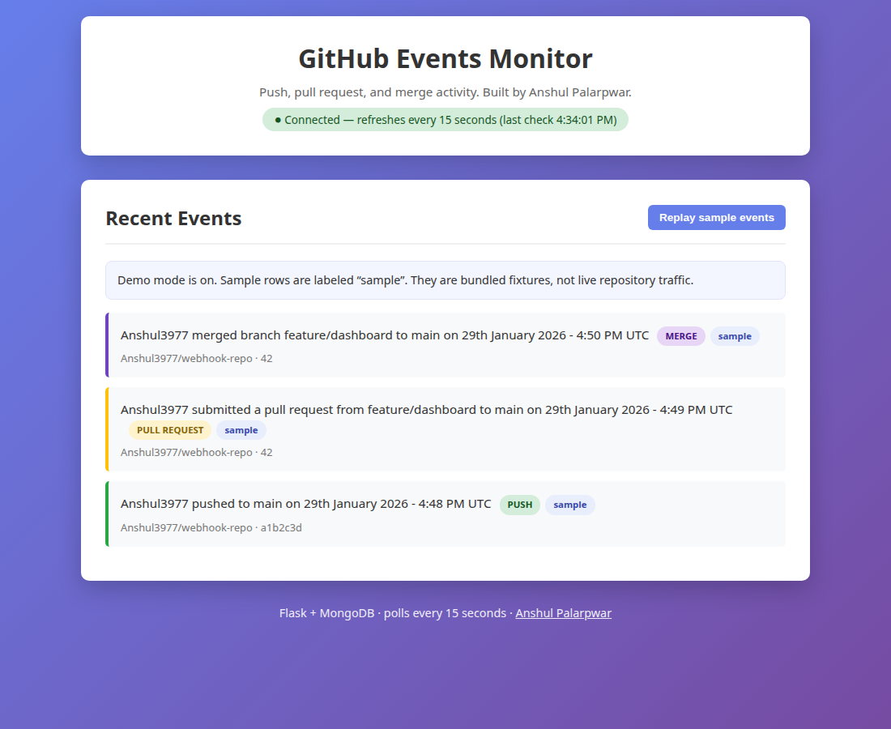
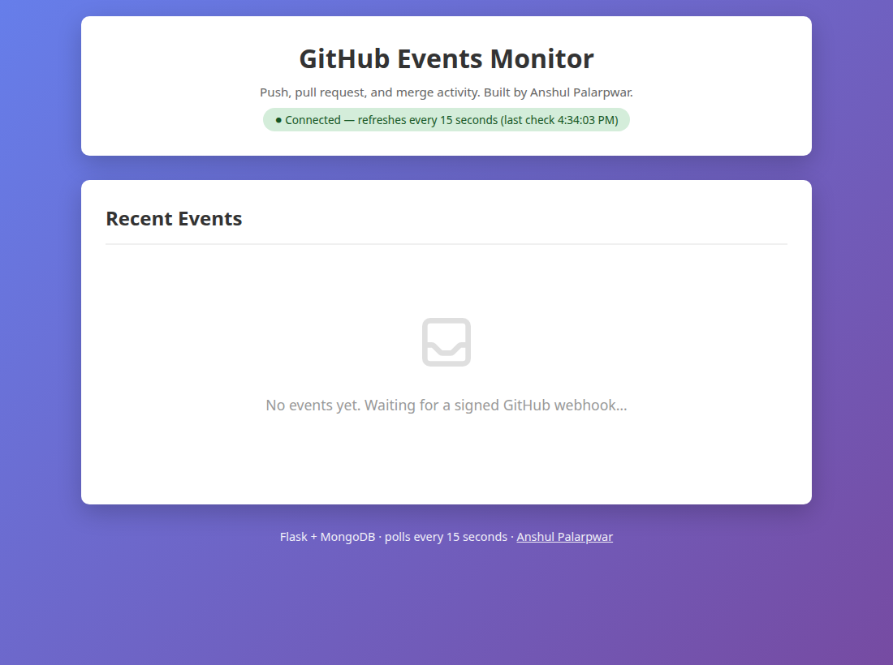
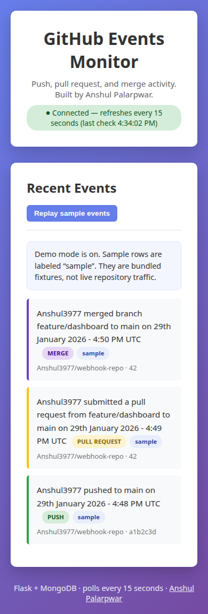
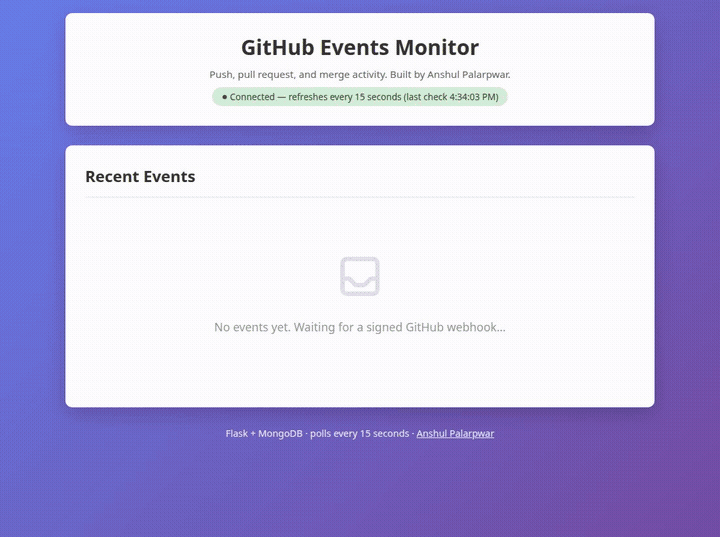
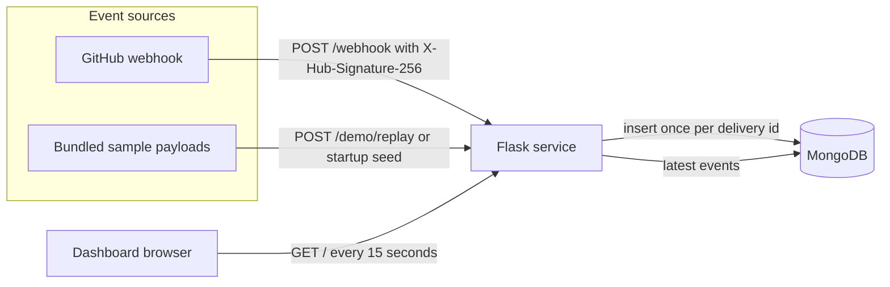

# Webhook Event Monitor

A small backend that receives GitHub webhooks, checks the signature, stores each delivery once in MongoDB, and shows the latest push, pull request, and merge activity on a dashboard.

Anshul Palarpwar built this as a portfolio project for new-grad backend roles. It is one Flask service and one database. It is not a multi-tenant product, and this README does not claim users, traffic, or uptime numbers.

## Live demo

Not deployed yet. After the [Render](#deploy-on-render) steps, replace this line with the service URL from the Render Dashboard:

> `https://<your-service-name>.onrender.com`

Until that exists, run the app locally with demo mode. The screenshots below are from that local run. The rows labeled **sample** are the bundled fixtures in `samples/`, not events from a live repository.









The first and third images are demo mode, so each row is labeled sample. The empty image and the GIF use demo mode off. The GIF posts the same three fixture files to `/webhook` with a valid signature, then reloads the page. Those rows are real stored events from that local request, not traffic from GitHub.

## How it works



GitHub does not send a separate merge event. A merge is a `pull_request` delivery whose action is `closed` and whose `merged` field is true. Opening or reopening a pull request is stored as `pull_request`. Other pull request actions, tag pushes, branch deletions, and the `ping` event are acknowledged and not stored.

## Features

- Verifies `X-Hub-Signature-256` with `WEBHOOK_SECRET` before parsing the body. Comparison is constant-time. If the secret is unset, `POST /webhook` returns 503 and writes nothing.
- Stores `push`, opened or reopened `pull_request`, and merged pull requests.
- Idempotent on `X-GitHub-Delivery`. A retry returns `200` with `status: duplicate` and does not insert a second row.
- Rejects malformed JSON, the wrong content type, and payloads that do not match the fields this service stores. Errors are JSON objects with a `code` and a `message`. Response bodies do not include stack traces.
- Dashboard polls `GET /events` every 15 seconds and keeps the existing purple-card layout. Sample rows are labeled so they are not mistaken for live traffic.
- Demo mode replays three checked-in payloads so the page is not empty when no repository is pointed at it.
- `GET /health` for Render. The process returns 200 even if MongoDB is briefly unreachable, and the body says whether the database answered.

## Stack

- Python 3.12, Flask, Gunicorn
- MongoDB (local via Docker Compose, or Atlas M0 when deployed)
- Docker
- pytest and mongomock
- ruff
- GitHub Actions
- Render free web service

## Quickstart

Python 3.11 or newer, and either a local MongoDB or Docker.

```bash
git clone https://github.com/Anshul3977/webhook-repo.git
cd webhook-repo
python -m venv .venv
source .venv/bin/activate
pip install -r requirements.txt -r requirements-dev.txt
cp .env.example .env
```

Edit `.env` and set `WEBHOOK_SECRET` to a long random string. Generate one with:

```bash
python -c "import secrets; print(secrets.token_urlsafe(32))"
```

Start MongoDB and the app with Compose (Compose reads `WEBHOOK_SECRET` from `.env`):

```bash
docker compose up --build
```

Or run the process yourself while MongoDB listens on `localhost:27017`:

```bash
python app.py
```

The app binds to `0.0.0.0` and the port in `PORT` (default `5000`). Open `http://localhost:5000`.

With `DEMO_MODE=true`, three sample events are inserted at startup. Replay them through the real webhook route:

```bash
WEBHOOK_SECRET=the-value-from-dotenv WEBHOOK_URL=http://localhost:5000/webhook \
  python scripts/replay_demo.py
```

The script signs each body. Running it twice does not create duplicate rows.

Tests and lint:

```bash
ruff check .
ruff format --check .
pytest
```

## Point a GitHub repository at it

1. Deploy the service and copy its HTTPS URL.
2. In the GitHub repository, open **Settings → Webhooks → Add webhook**.
3. Payload URL: `https://<your-service>.onrender.com/webhook`
4. Content type: `application/json`. Form-encoded payloads are rejected.
5. Secret: the same value as `WEBHOOK_SECRET`.
6. Enable SSL verification.
7. Choose **Let me select individual events** and enable **Pushes** and **Pull requests**. A merged pull request arrives as a pull request event. You do not need a separate merge subscription.
8. Save. GitHub sends a `ping`. The service answers `200` and does not store it.
9. Push a commit, open a pull request, and merge it. The dashboard updates on the next 15-second poll.

The dashboard is public. Anyone who has the URL can read recent event metadata (author, branch names, repository full name, commit SHA or pull request id). Do not point a private repository at it if those fields should stay private. The webhook secret stops unauthenticated clients from inserting events. It does not hide the dashboard.

## Demo mode

`DEMO_MODE=true` does two things:

- On startup, inserts `samples/push.json`, `samples/pull_request.json`, and `samples/merge.json` if those delivery ids are not already stored.
- Allows `POST /demo/replay` without a token. The route ignores any request body and only replays those three files.

When `DEMO_MODE` is not true, `POST /demo/replay` requires the header `X-Demo-Token` to match `DEMO_TOKEN`.

Leave demo mode on for a portfolio deploy so a visitor sees rows. Set `DEMO_MODE=false` when a real repository webhook is the source you want to show. Existing sample rows stay until you delete them in MongoDB. They remain labeled `sample`.

## Configuration

| Variable | Required | Purpose |
| --- | --- | --- |
| `MONGO_URI` | Yes, in production | MongoDB connection string. Local default is `mongodb://localhost:27017/`. |
| `MONGO_DB` | No | Database name. Default `github_events`. |
| `MONGO_COLLECTION` | No | Collection name. Default `events`. |
| `WEBHOOK_SECRET` | Yes, to accept webhooks | HMAC secret shared with GitHub. |
| `DEMO_MODE` | No | `true`, `1`, `yes`, or `on` enables demo replay. Anything else, including `false`, leaves it off. |
| `DEMO_TOKEN` | When demo mode is off | Protects `POST /demo/replay`. |
| `LOG_LEVEL` | No | Default `INFO`. Logs include delivery id and action, not the raw payload or secrets. |
| `PORT` | Set by Render | Listen port. Local default `5000`. |
| `FLASK_DEBUG` | No | Enables the Flask debugger only for `python app.py`. Leave it unset on Render. |

Copy `.env.example` to `.env` for local work. `.env` is gitignored.

## Deploy on Render

The service is a Docker web service on the **free** compute plan (`plan: free` in `render.yaml`): 0.1 CPU, 512 MB RAM, one instance. The Blueprint does not provision Render Postgres. Free Render Postgres expires 30 days after creation, and this app already uses MongoDB. You create the Atlas cluster yourself and paste the URI in as a secret.

`render.yaml` is on this branch. Render reads the Blueprint from the repository's default branch, so merge the pull request before applying it.

1. Merge the pull request into `main`.
2. Open the Blueprint page: [https://dashboard.render.com/blueprint/new?repo=https://github.com/Anshul3977/webhook-repo](https://dashboard.render.com/blueprint/new?repo=https://github.com/Anshul3977/webhook-repo)
3. Connect GitHub if Render asks you to.
4. Review the service `webhook-event-monitor`. It is a `web` service, `runtime: docker`, `plan: free`, region `oregon`, health check path `/health`. Change the region before you apply if you want the service closer to a different Atlas region. The region cannot be the reason you pick a paid plan; free web services are available in Render's standard regions, including Oregon.
5. When prompted, set:
   - `MONGO_URI` to the Atlas SRV string from the next section. Do not paste it into git.
   - `WEBHOOK_SECRET` to a long random string. Use the same value as the GitHub webhook secret.
6. Leave the other variables as declared: `MONGO_DB=github_events`, `MONGO_COLLECTION=events`, `DEMO_MODE=true`, `LOG_LEVEL=INFO`. `DEMO_TOKEN` is generated by Render the first time the Blueprint is applied. You do not need to type it while demo mode is on.
7. Click **Apply** and wait until the deploy is **Live**. Render sends `GET /health` and accepts any 2xx or 3xx response within five seconds.
8. Open the `onrender.com` URL from the Dashboard. You should see the three sample events. Put that URL in the live-demo section above.
9. Add the GitHub webhook using that URL.

Automatic deploys use `autoDeployTrigger: checksPass`, so Render deploys a commit after the GitHub Actions checks pass. The container listens on `0.0.0.0:$PORT`. Render sets `PORT`. Do not hardcode it.

The free plan spins the service down after 15 minutes without inbound traffic. The next request wakes it, which takes about a minute, and Render shows a loading page while that happens. See [Limitations](#limitations).

## MongoDB Atlas

Create a free cluster (Atlas still calls this tier a Free cluster; it is the M0 sandbox, and a project can have only one). These steps follow the current Atlas UI labels: **Clusters**, **Database & Network Access**, **IP Access List**, and **Database Users**.

1. Sign in at [https://cloud.mongodb.com](https://cloud.mongodb.com) and create or select an organization and a project.
2. In the sidebar, open **Clusters** under **Database**. Click **Build a Cluster** (first cluster) or **Create**.
3. Select the **Free** cluster. Do not select Flex or a dedicated tier such as M10. Those are billed.
4. Choose a cloud provider and region close to the Render service. For the Blueprint's `oregon` region, AWS `us-west-2` (Oregon) is a reasonable choice.
5. Name the cluster, for example `webhook-monitor`. The name cannot be changed later, must be at most 64 characters, and a name shorter than 23 characters cannot end with a hyphen.
6. Click **Create**. If Atlas asks for a credit card, you are not on the Free cluster. Go back and select Free. Confirm the deploy.
7. Create a database user that can write only this app's database.
   - Sidebar: **Database & Network Access** under **Security**.
   - Open the **Database Users** tab and click **Add New Database User**.
   - Authentication method: **Password**.
   - Username: `webhook_app`.
   - Click **Autogenerate Secure Password** and store the password in a password manager. You will not see it again.
   - Privileges: do not leave a project-wide admin role in place. Expand **Specific Privileges**, add `readWrite`, and set the database to `github_events`. Leave the collection blank so the privilege covers that database, including the `events` collection. Remove the broader built-in role. Atlas only shows delete once another privilege is selected.
   - Turn **Restrict Access to Specific Clusters** on and select this cluster only.
   - Leave **Temporary User** off.
   - Click **Add User**.
8. Allow the Render service to connect. Free web services do not have a stable outbound IP, so an IP allow list of one address will break the next time the instance is rescheduled.
   - On **Database & Network Access**, open **IP Access List** and click **Add IP Address**.
   - Enter `0.0.0.0/0`.
   - Comment: `Render free web service has no static egress IP`.
   - Do not save it as a temporary entry. Temporary entries expire and the app will fail to connect.
   - Confirm. Atlas emails project members when an entry uses a `/0` range. That email is expected.
9. On the cluster, click **Connect → Drivers**, choose Python, and copy the SRV string. It looks like:

   ```text
   mongodb+srv://webhook_app:<password>@webhook-monitor.example.mongodb.net/?retryWrites=true&w=majority
   ```

   Replace `<password>` with the user password. If the password contains reserved characters (`/`, `@`, `:`, `#`, `%`, and so on), [percent-encode](https://en.wikipedia.org/wiki/Percent-encoding) them. You can put the database name in the path:

   ```text
   mongodb+srv://webhook_app:<encoded-password>@<cluster-host>/github_events?retryWrites=true&w=majority
   ```

10. Set that entire string as `MONGO_URI` on the Render service. The database and collection are created on the first insert. You do not need to create them in the Atlas UI.

`0.0.0.0/0` means any host that has the username and password can open a connection. The compensating controls in this project are the single-database `readWrite` user, a long random password, and the webhook HMAC so strangers cannot write events through the HTTP API. Restrict the access list to specific IPs if you later move the web service to a plan with stable egress.

The app depends on `dnspython` so `mongodb+srv://` URIs resolve.

## Design decisions

- **Signature over the raw body.** GitHub signs the exact bytes it sent. The app reads those bytes and checks `sha256=` before it parses JSON. Re-serializing the payload would break the signature.
- **Fail closed.** A missing `WEBHOOK_SECRET` is a configuration error, not an open webhook.
- **Delivery id as the idempotency key.** GitHub retries with the same `X-GitHub-Delivery`. A unique index on `delivery_id` is what makes the write safe if two requests overlap. The HTTP status stays 200 so GitHub stops retrying.
- **Ignore events we do not display.** A 400 on a `labeled` pull request would make GitHub retry an event we will never store. Those deliveries return 200 with `status: ignored`. A payload that claims to be a push or pull request but is missing required fields returns 400 with `code: invalid_payload`.
- **UTC timestamps.** Values are normalized to `YYYY-MM-DDTHH:MM:SSZ` before they are stored, and the sentence uses that UTC time. An offset such as `-05:00` is converted rather than labeled UTC while still showing the original clock time.
- **Branch names keep their slashes.** `refs/heads/feature/dashboard` is stored as `feature/dashboard`, not `dashboard`.
- **Polling.** The page asks for the latest 50 events every 15 seconds. That matches the original dashboard and avoids holding a WebSocket open on a service that sleeps. Each poll replaces the list from the server, so an event whose commit time is older than the newest row is still shown.
- **Health check does not require MongoDB.** Render restarts an instance that fails `/health`. Restarting does not fix a bad Atlas URI or access list. `/health` returns 200 when the process is up, and `database` is `ok` or `unavailable`. `GET /events` returns 503 when the database is down.
- **Demo writes are not a general insert API.** `/demo/replay` cannot store a payload the caller supplies.
- **One Gunicorn worker and four threads.** The free instance has 512 MB of RAM. PyMongo's client is safe to share across those threads. The Docker `CMD` uses `exec` so Gunicorn receives `SIGTERM` on shutdown.

## Data stored for each event

```json
{
  "author": "Anshul3977",
  "action": "push",
  "to_branch": "main",
  "from_branch": null,
  "timestamp": "2026-01-29T16:48:00Z",
  "request_id": "commit sha or pull request id",
  "delivery_id": "github delivery id",
  "repository": "Anshul3977/webhook-repo",
  "source": "github"
}
```

`source` is `demo` for bundled fixtures. Sentences on the dashboard:

- `Anshul3977 pushed to main on 29th January 2026 - 4:48 PM UTC`
- `Anshul3977 submitted a pull request from feature/dashboard to main on 29th January 2026 - 4:49 PM UTC`
- `Anshul3977 merged branch feature/dashboard to main on 29th January 2026 - 4:50 PM UTC`

## API

| Method | Path | Behavior |
| --- | --- | --- |
| `GET` | `/` | Dashboard. |
| `GET` | `/health` | `{"status":"healthy","database":"ok"}` or `"unavailable"`. Always 200 when the process is up. |
| `POST` | `/webhook` | Signed GitHub webhook. |
| `GET` | `/events` | Latest events. Query params: `limit` (1–100, default 50), `action` (`push`, `pull_request`, `merge`), `since` or `last_timestamp` (ISO-8601). |
| `POST` | `/demo/replay` | Replays the three sample payloads. |

Webhook success bodies use `status` of `stored`, `duplicate`, or `ignored`. Failures look like:

```json
{"error": {"code": "invalid_signature", "message": "The webhook signature is missing or invalid."}}
```

Codes include `invalid_signature` (401), `invalid_payload` (400), `invalid_json` (400), `invalid_content_type` (400), `invalid_query` (400), `webhook_not_configured` (503), `database_unavailable` (503), and `demo_unauthorized` (401).

## Tests and CI

GitHub Actions (`.github/workflows/ci.yml`) runs three jobs on pull requests and on pushes to `main`:

- `ruff check` and `ruff format --check`
- `pytest` (mongomock, no external database)
- `docker build`, then a container smoke test of `GET /health`

The tests cover signature success and failure, push, pull request, and merge parsing, duplicate delivery ids, and `GET /events`.

## Limitations

- **The free Render service sleeps.** After 15 minutes without a request, the process is spun down. The next HTTP request wakes it, which takes about a minute. GitHub's webhook timeout is 10 seconds, so a delivery that arrives while the service is asleep usually fails that attempt. GitHub retries failed deliveries. A later retry can succeed once the instance is awake, but delivery on the free plan is not reliable. A paid Render instance that does not sleep is the fix if a repository depends on every webhook landing.
- **750 free instance hours per workspace per month.** Hours are not used while the service is spun down. If the workspace uses the monthly allowance, Render suspends free web services until the next month. This README does not guess how many hours this service will use.
- **One instance, no disk, ephemeral filesystem.** Nothing important is stored on disk. Events are in MongoDB.
- **Atlas free-cluster limits.** One free cluster per Atlas project, shared RAM and storage limits, and Atlas can pause free clusters after long inactivity. Those limits are Atlas's, and they are enough for a portfolio demo.
- **Public read of recent events.** There is no login on the dashboard.
- **`0.0.0.0/0` on the Atlas access list** is a stand-in for Render's changing egress addresses. It is not a general recommendation for a database that holds private data.
- **No websocket, no user accounts, no replay of arbitrary JSON, no secret rotation workflow.** Rotating `WEBHOOK_SECRET` means updating Render and the GitHub webhook, then redeploying.
- **Sample events are fixtures.** The author on those rows is the GitHub login `Anshul3977` because that is whose repository this is. They are not a count of users.

## History

The two commits that were already on `main` were searched for secrets, passwords, cloud keys, and MongoDB SRV URLs. None were found. History was not rewritten.

## Project layout

```text
app.py                      Gunicorn entrypoint
webhook_monitor/            Application package
templates/index.html        Dashboard
samples/                    Bundled webhook fixtures
scripts/replay_demo.py      Signed replay of those fixtures
tests/                      pytest suite
Dockerfile                  Image used by Render
docker-compose.yml          Local app + MongoDB
render.yaml                 Render Blueprint
.github/workflows/ci.yml    Lint, tests, Docker build
```

## Author

Anshul Palarpwar — [github.com/Anshul3977](https://github.com/Anshul3977)
